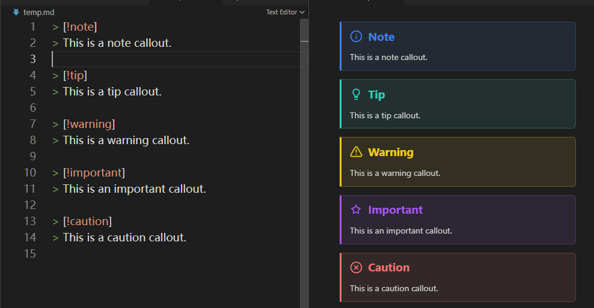
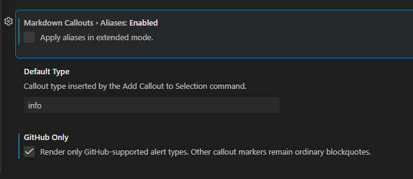
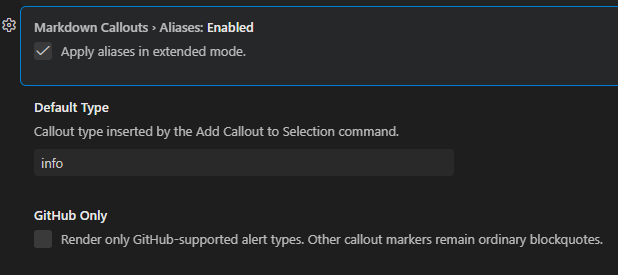
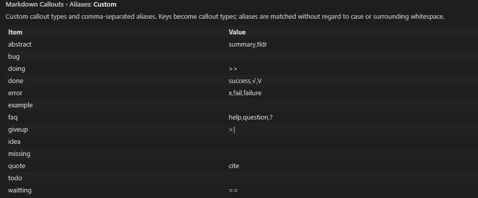
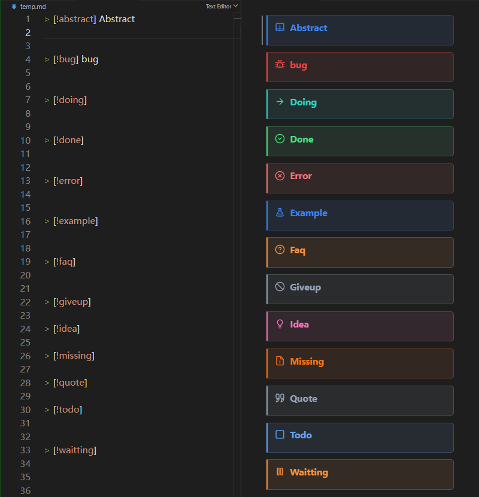
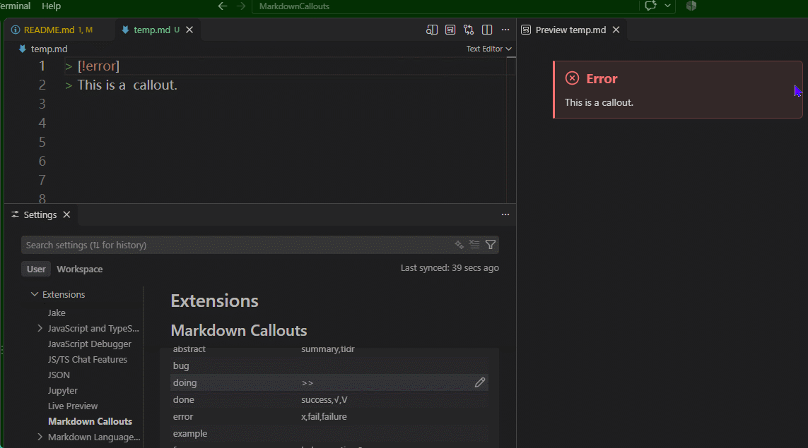
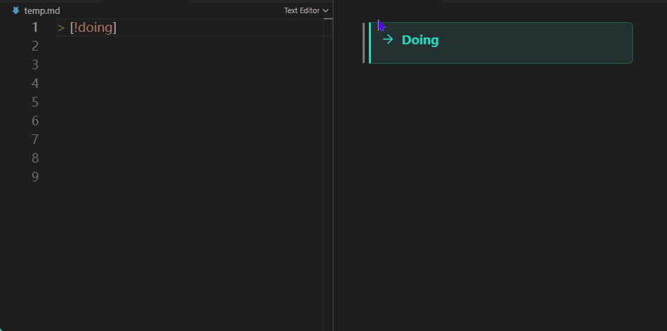
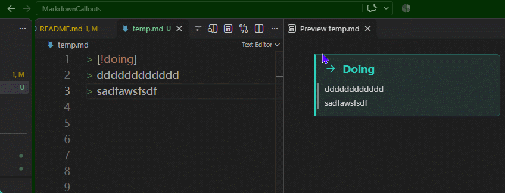
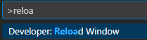

# Markdown Callouts

Use callouts `> [!type]` in markdown like GitHub  and Obsidian.

> [!note] 
> It works well with `foam` and `Markdown All in One`.

# Features
## Github Only Mode
If you just want use callouts that support by GitHub.


```markdown
> [!note] 
> This is a note callout.

> [!tip]
> This is a tip callout.

> [!warning]
> This is a warning callout.

> [!important]
> This is an important callout.

> [!caution]
> This is a caution callout.
```



> [!warning] 
> Github  don't support callouts titles.
> So don't include a title after the callout type.

### Config: Just use GitHub callouts
- ☑ Active (GitHub-only mode)
- ☐ Disabled Aliases



## Free Mode : Use any callouts and set aliases
Ensure the github-only mode is disabled to use any callouts and set aliases.


I have add some common callouts and their aliases for extended mode.





### You can add any aliases for them.


### Add `-` for foldable callouts
```markdown
> [!note]- Foldable note
> This callout starts collapsed.
```



## Commands

- **Markdown Callouts: Add Callout to Selection** wraps selected lines using `markdownCallouts.defaultType` (default: `info`).
- **Markdown Callouts: Remove Callout from Selection** removes the marker and quote prefixes from selected callout lines.



## Aliases

Built-in aliases can be changed in `markdownCallouts.aliases.builtin`. Custom types and aliases are configured in `markdownCallouts.aliases.custom`:

```json
{
  "markdownCallouts.aliases.custom": {
    "idea": "thought,proposal",
    "done": "complete,√"
  }
}
```

Alias matching ignores case and surrounding whitespace. Comma-separated values are supported. Set `markdownCallouts.aliases.enabled` to `false` to disable aliases in extended mode.

## Styling

Built-in types have distinct colors. Custom callouts use a blue default and can be styled in a workspace stylesheet configured through VS Code's `markdown.styles` setting:

```css
.markdown-callout[data-callout="idea"] {
  --callout-color: 244, 114, 182;
}
```

The `--callout-color` value uses comma-separated RGB components. To change an icon, set `--callout-icon` on `.markdown-callout-icon` to a CSS mask URL. Custom styles can target `.markdown-callout[data-callout="your-type"]`.

## Development

```sh
npm install
npm run compile
npm run lint
npm test
```

Callout rendering and selection-editing code in this extension is adapted from the MIT-licensed Foam project. See [LICENSE](./LICENSE) and [THIRD_PARTY_NOTICES.md](./THIRD_PARTY_NOTICES.md) for attribution and license details.


## Config 
You should reload window to apply changes to the configuration settings.
